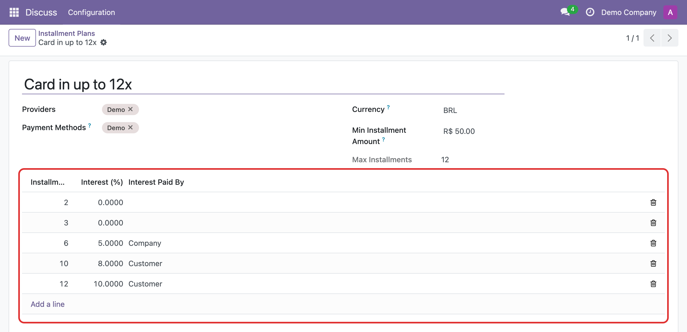

The *Installments* tab is shown on the providers whose module supports
installments.

1. Open the provider and go to the *Installments* tab.
2. Create a plan: pick the payment methods it applies to (Card by default) and
   add one line per option, with the number of installments, the interest in
   percent of the amount and who pays it.
3. Optionally set a minimum installment amount.

The single installment is always offered and needs no line.
