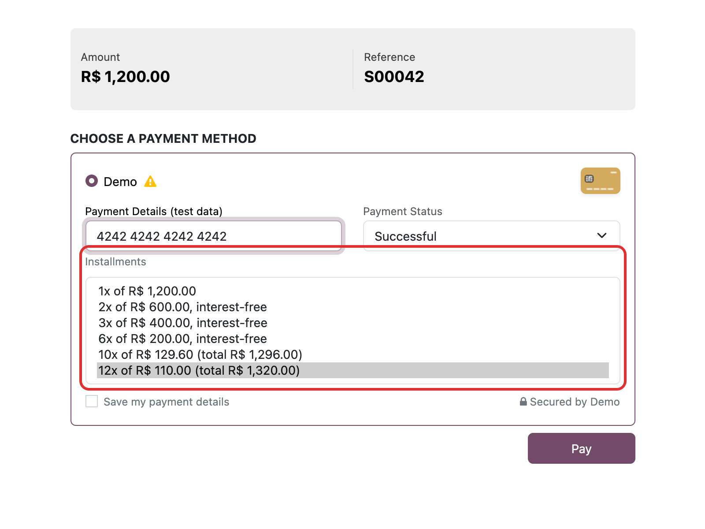
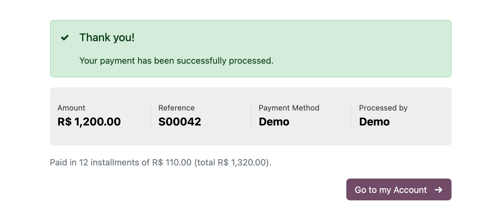
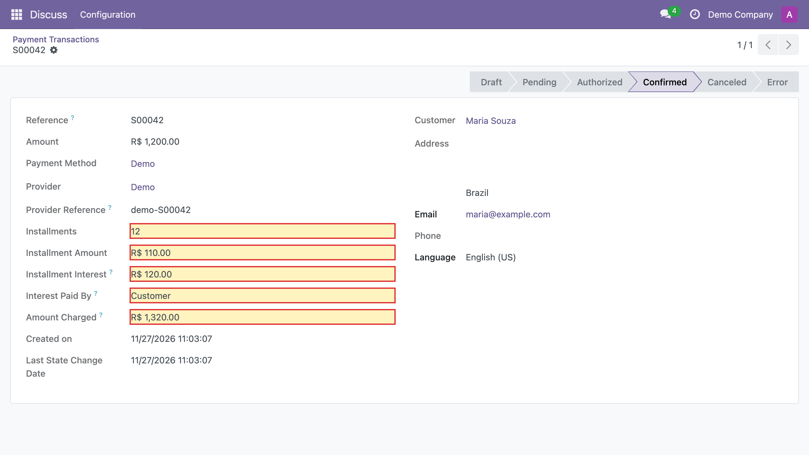

On the payment form, the payer picks the payment method and then the number of
installments:

The confirmation page shows how the payment was split:

The transaction keeps what was chosen:

When the interest is paid by the customer, the payer is charged the amount
plus the interest (*Amount Charged*); the amount of the transaction stays the
amount of the document being paid. When it is paid by the company, the option
is shown as interest-free and the interest is recorded on the transaction.

**For provider modules**

- set `support_installments` in `_compute_feature_support_fields`;
- read `installments` on the transaction when building the payment request;
- write `installments` and `amount_charged` if the gateway reports other
  values.
