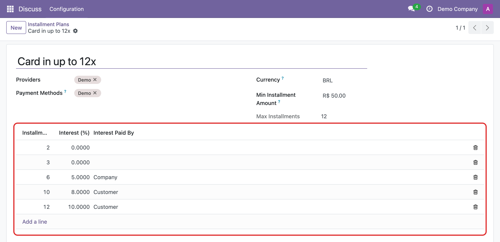

An installment plan lists the options offered to the payer. Each option has the
number of installments, the interest and who pays it:

On the payment form, the payer picks the payment method and then the number of
installments. Options whose interest is paid by the company are shown as
interest-free:

The confirmation page tells the payer how the payment was split:

The transaction keeps what was chosen:

**Who pays the interest**

- *Customer*: the provider charges the payer the amount plus the interest. The
  amount of the transaction stays the amount of the document being paid, and
  *Amount Charged* shows what the payer pays in total.
- *Company*: the payer pays the amount, interest-free. The interest is a cost of
  the sale for the company, recorded on the transaction for accounting and
  reconciliation.

**For developers of provider modules**

- read `installments` and `installment_interest_bearer` on the transaction (also
  present in the processing values) when building the payment request;
- declare where the provider reports the installment data by extending
  `payment.transaction._get_installment_notification_mapping`, or write the
  fields directly when processing the notification.

A transaction created by another process (an order imported from a sales
channel, a point of sale) can carry any number of installments: the plans are
only enforced when the payer chooses on the payment form.
